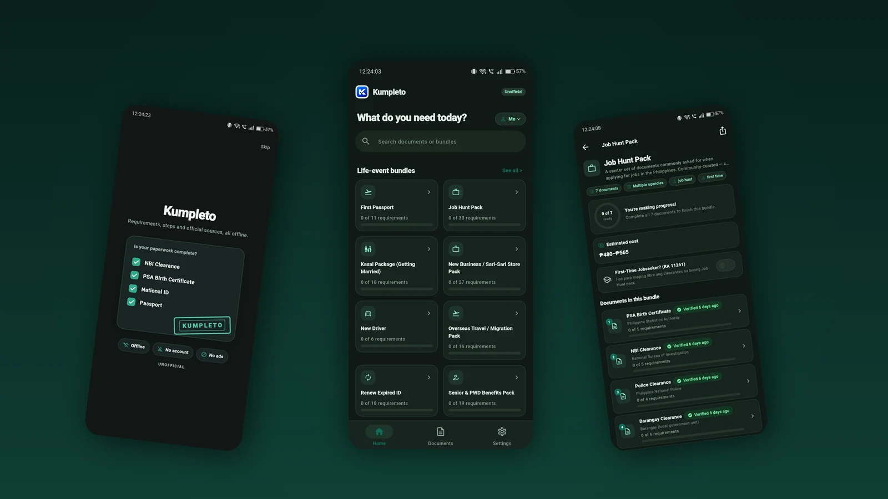
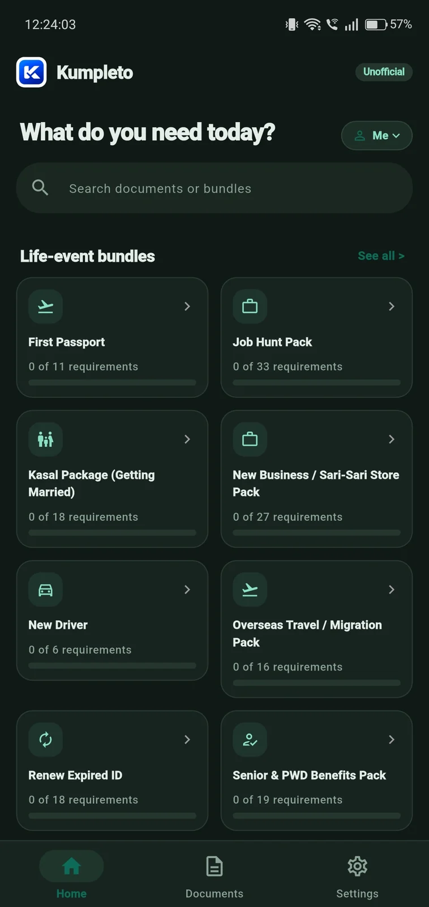
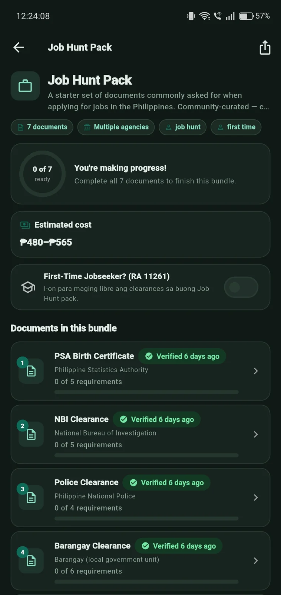
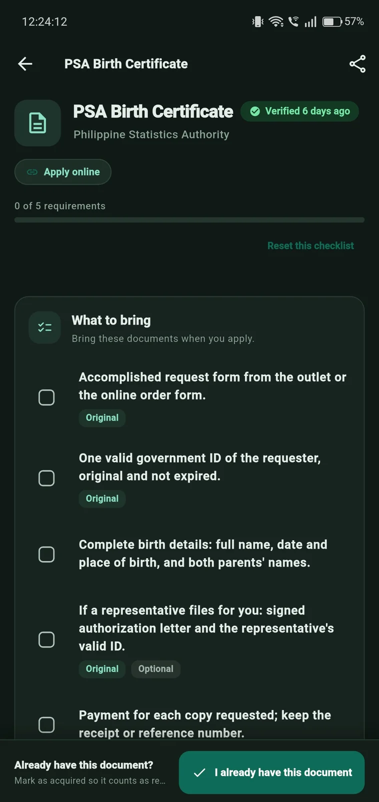
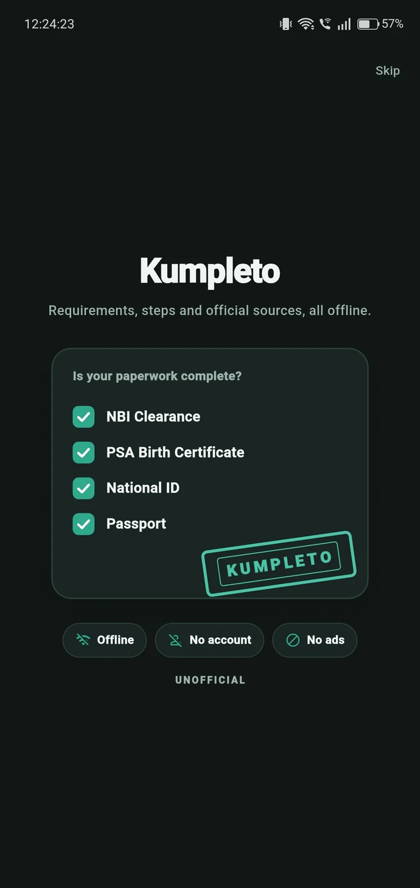

# Kumpleto

**Unofficial.** Kumpleto is an offline-first Android app that keeps a
community-maintained checklist of Philippine government document
requirements — NBI clearance, PSA certificates, passport, national ID, LTO
licences and permits, DTI business names, PRC licences, and more — plus
life-event bundles (Job Hunt Pack, First Passport, New Driver, Renew Expired
ID, Kasal, Senior & PWD Benefits, Overseas Travel).

> **Disclaimer:** Kumpleto is **not** a government app and is **not
> affiliated with any government agency**. Requirements and fees change.
> Always confirm with the official agency website (linked inside every
> document entry) before you apply. See [DISCLAIMER.md](DISCLAIMER.md).

## Why

Preparing Philippine government documents usually means scattered PDFs,
forum posts, and word of mouth. Kumpleto gathers the *requirements*, *steps*,
and *official source link* for each document into one checklist you can tick
off — fully usable **offline**, with **no accounts, no analytics, and no ads**.

## Features

- ✅ Per-document requirement checklists (originals, photocopies, optionals)
- 👥 Per-person checklists — add the other people you file for, each with its
  own saved barangay, city and postal code
- 📦 Life-event bundles with per-document and overall progress
- 🌐 English + Filipino interface and content
- 📴 Works 100% offline on first launch (data bundled as an asset)
- 🔄 Silent data refresh from a public JSON feed — no app release needed
- 🔍 Search runs through requirements, steps, fees and notes, not just titles
- 🔗 Deep links per document and bundle (`kumpleto://doc/<id>`,
  `kumpleto://bundle/<id>`) for sharing a single checklist
- 🔔 Expiry reminders a month, a week and a day before an acquired document
  lapses (off until you switch it on in Settings, which is when the OS
  notification permission is asked for)
- 🔒 No accounts, no analytics, no crash reporting, no data leaves your device
- ♿ TalkBack labels, 48dp touch targets, works at 200% font size

## Release status

**Version 1.0.0 (versionCode 1)** — first public release.

- Artifacts from `flutter build apk --flavor prod --release` and
  `flutter build appbundle --flavor prod --release`:
  `app/build/app/outputs/flutter-apk/app-prod-release.apk` (universal, three
  ABIs, 71.5 MB) and
  `app/build/app/outputs/bundle/prodRelease/app-prod-release.aab`
  (the Play upload format, 65.8 MB on disk; Play delivers roughly the arm64
  split, about 23 MB per device).
- A release build carries the verified dataset only — 37 documents, 9 bundles,
  19 agencies. Draft entries never ship, and the bundled `data.json` hash must
  equal `dist/data.json`.
- Store signing: the AAB is signed with the upload key only when
  `app/android/key.properties` exists; otherwise it stays debug-signed for QA
  and cannot be uploaded. See [docs/PLAY_RELEASE.md](docs/PLAY_RELEASE.md) §2.

## Build (development)

Prerequisites: Flutter (see `.fvmrc` for the pinned version), Android SDK
with platform 36, JDK 17+.

```powershell
# 1. Compile the data (repo root)
dart pub get
dart run tools/validate.dart          # schema + semantic validation
dart run tools/build_data.dart        # writes dist/ + app/assets/data/data.json

# 2. Run the app (app/)
cd app
flutter pub get
flutter run --flavor dev              # debug; shows drafts too if generated
```

To include draft entries for development:

```powershell
dart run tools/build_data.dart --include-drafts   # gitignored dev asset
flutter run --flavor dev
```

Release build (never contains drafts):

```powershell
cd app
flutter build appbundle --flavor prod --release
```

Tests:

```powershell
dart test tools/test  # tool tests (repo root)
cd app && flutter test # app tests
```

## Data contribution flow

1. All content lives in `data/**.yaml` — see [docs/DATA_GUIDE.md](docs/DATA_GUIDE.md).
2. **Every factual field must cite an official source URL.** Never invent
   requirements, fees, processing times, or validity periods. If unsure,
   leave it `null` and keep `status: draft`.
3. Only a maintainer may set `status: verified` and `last_verified`.
4. CI validates every change (`tools/validate.dart --strict`); the app picks
   up new data through the public feed without a Play release.

See [CONTRIBUTING.md](CONTRIBUTING.md) for the full guide.

## Screenshots

Real captures from the app running on an Android phone (1080 × 2400, cropped
to drop the system navigation bar). The same four are the Play listing shots.



| Home | Life-event bundle |
|---|---|
|  |  |
| Search over documents and bundles, life-event bundles with per-bundle progress, and the three tabs (Home, Documents, Settings). | One bundle: documents in order, overall progress, estimated cost range, and the first-time jobseeker fee-waiver toggle. |

| Document checklist | Welcome |
|---|---|
|  |  |
| Requirements tagged original or optional, the official source link, and the sticky "I already have this document" bar. | First launch: what the app is, and the three promises — offline, no account, no ads. |

## Privacy

No data is collected. The only network request is fetching the public
data bundle. See [PRIVACY.md](PRIVACY.md).

## License

- Source code: [MIT](LICENSE)
- Content under `data/`: [CC BY 4.0](LICENSE-DATA)
